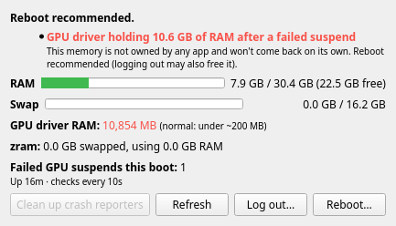

# mem-watch

A small system-tray app for Linux (KDE Plasma / SteamOS desktop mode) that watches RAM, swap, GPU-driver-held memory and crashes, and tells you when it's time to reboot.



## Why

On a desktop running SteamOS with an Intel Arc (Battlemage) card, the `xe` driver can fail to suspend:

```
xe 0000:03:00.0: PM: failed to suspend async: error -22
```

Before suspending, the driver copies VRAM contents into system RAM. When the suspend fails, that copy isn't freed. On a 32 GB machine about 10 GB disappeared, and no process owned it. `free` showed 22 GB used, swap filled up, and programs started crashing. The only visible trace is the `GPUActive` line in `/proc/meminfo`.

mem-watch watches for that, plus the general signs of memory trouble.

## What it does

- **Tray icon:** a memory chip that fills as RAM is used. Green means OK, yellow a warning, red critical. Hover for a quick summary.
- **Status window** (left-click): RAM and swap bars, RAM held by the GPU driver, zram usage, failed GPU suspends and crashes this boot, and leftover crash reporters. Buttons to clean up reporters, log out or reboot. Log out and reboot use KDE's own confirmation dialog.
- **Notifications:** one notification per new problem. You get another only if the problem gets worse or comes back.

| Check | Warns when |
|---|---|
| GPU driver memory (`GPUActive`) | over 2 GB (critical, reboot recommended) |
| `xe` suspend failure | found in this boot's kernel log |
| Available RAM | under 15% (warning) / 7% (critical) |
| Swap | over 70% (warning) / 90% (critical) |
| New crashes | a new entry in `coredumpctl` |
| Stale crash reporters | `drkonqi` processes older than 1 hour |

Memory is read from `/proc` every 10 s. The journal, coredump and process checks run every 60 s. No root needed.

## Install

Requires Python 3 and a desktop with a system tray (StatusNotifierItem), e.g. KDE Plasma.

```bash
git clone https://github.com/codingdoctorbot/mem-watch.git
cd mem-watch
./install.sh
```

`install.sh` creates a virtualenv with PyQt6 in the project folder (nothing is installed system-wide, so it survives SteamOS updates). It also adds an autostart entry and an app-menu entry. To start it right away without logging out:

```bash
.venv/bin/python mem_watch.py &
```

Uninstall:

```bash
./install.sh --remove
```

## Testing

Simulate the leak to see what an alert looks like:

```bash
.venv/bin/python mem_watch.py --fake-gpu-gb 10.6 --fake-suspend-fail --show
```

Quit any running instance first (right-click the tray icon → Quit). Only one instance runs at a time.

## Workaround for the underlying bug

Until the kernel driver is fixed, turn off automatic sleep: System Settings → Power Management → *When inactive: Do nothing*. A reboot frees the stuck memory. Logging out may also work.

## License

MIT
